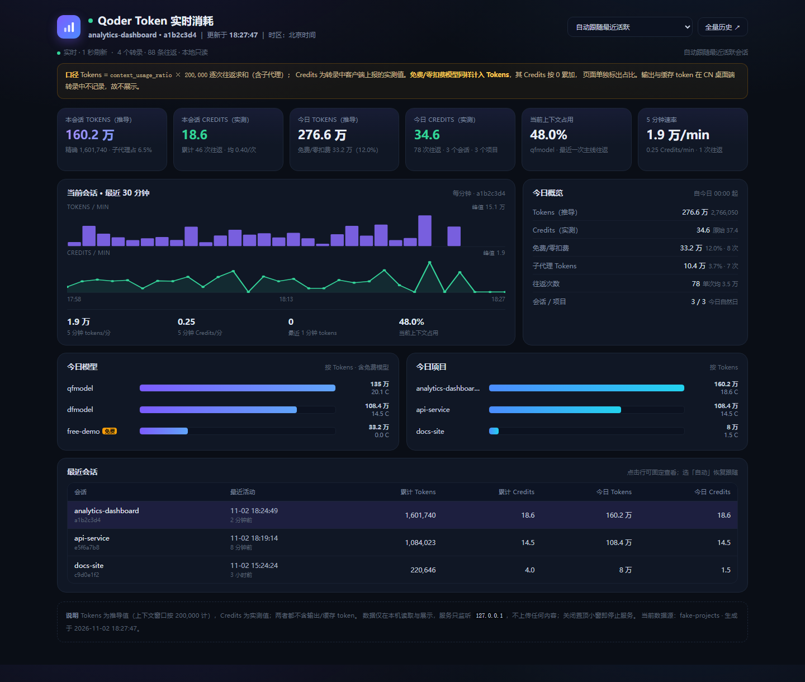

# Qoder CN Token 用量实时面板

一个只读、本机运行的 Qoder CN 桌面端用量小工具：从会话转录中读取每次模型往返的 `usage`，实时显示 **Tokens、Credits、上下文占用、今日/会话排行**，并提供始终置顶的小窗与浏览器面板。

> 预览图使用假数据生成，仅用于展示界面。



## 特性

- **1 秒刷新**：增量 tail 转录文件，新对话出现后 1–2 秒内更新。
- **置顶小窗**：360×196 无边框小窗，可拖动，显示本会话 Tokens/Credits、今日总量、上下文、5 分钟速率、免费/零扣费统计和 30 分钟迷你折线。
- **浏览器面板**：6 个 KPI、最近会话表、今日模型/项目排行、每分钟柱状/折线图；支持固定某个会话或自动跟随最近活跃会话。
- **全量历史**：生成静态 HTML / JSON / Qoder Canvas 快照，支持近 7/30/90 天与全部历史、按日/模型/项目查看、导出 CSV。
- **零第三方依赖**：仅使用 Python 标准库；`tkinter` 随官方 Python 安装。
- **只读、不上传**：只监听 `127.0.0.1`，不修改转录，不联网。

## 快速开始

### Windows

1. 安装 [Python 3.9+](https://www.python.org/downloads/)，安装时勾选 **Add Python to PATH**。
2. 下载本仓库 ZIP，或执行 `git clone https://github.com/H-cq/qodercn-token-usage.git`。
3. 双击 `启动Token实时面板.cmd`（或英文名 `start.cmd`）。
4. 启动后会自动打开浏览器，并在屏幕右上角显示置顶小窗。
5. 点小窗右上角 `×` 停止服务。

如果 Qoder 的数据目录不在默认位置（`%USERPROFILE%\.qoder-cn\projects`），用命令行指定：

```bat
python start.py --root "D:\path\to\.qoder-cn\projects"
```

### macOS / Linux

```bash
python3 start.py
```

- 需要 Python 3.9+ 与 `tkinter`（部分 Linux 发行版需单独安装 `python3-tk`）。
- 没有 `tkinter` 时会自动退回纯网页模式，不显示置顶小窗。
- 也可以使用 `bash start.sh`。

### 首次启动没有数据？

工具默认读取：

```
Windows:  %USERPROFILE%\.qoder-cn\projects
macOS/Linux: ~/.qoder-cn/projects
```

确认 Qoder CN 已经产生过对话，并且该目录存在。仍无法识别时，用 `--root` 或环境变量 `QODER_CN_PROJECTS` 指向实际目录。

## 指标口径

| 指标 | 来源 | 说明 |
|---|---|---|
| Tokens | `usage.context_usage_ratio` | 每次往返 `ratio × 200000` 后求和；是计费输入量的近似，不是当前上下文大小 |
| Credits | `usage.credits` | 客户端上报的实测值，逐条求和 |
| 原始 Credits | `usage.original_credits` | 折扣前数值，仅供对照 |
| 免费/零扣费 | `credits <= 0` | Tokens 照常计入，Credits 按 0 统计；界面单独标出 |
| 子代理 | `<session>/subagents/*.jsonl` | 计入总量，并标记来源 |
| 上下文占用 | 最近一条主链往返的 `ratio` | 显示为百分比；上下文压缩后会回落 |
| 输出 / 缓存 Tokens | 无 | CN 桌面端转录不记录，界面不展示，也不会显示成 0 |
| 今日 | 北京时间 00:00 起 | 固定 UTC+8；按记录时间过滤 |

几个容易误解的点：

1. **Tokens 会明显大于当前上下文。** 同一段上下文每次重发都会再次计入。
2. **200,000 是默认窗口假设。** 模型实际窗口不同会造成绝对值偏差，内部占比与趋势相对稳定。可用 `QODER_CN_WINDOW` 覆盖。
3. **免费判定是账单口径的近似。** `credits <= 0` 不等于套餐层面的“免费”，只代表该次上报为 0。
4. **不要用总 Tokens ÷ Credits 计算单价。** 两者口径不同，且含免费/折扣记录。

## 常用操作

| 操作 | 方式 |
|---|---|
| 固定会话 | 顶部下拉框选择，或点击“最近会话”表格行 |
| 恢复自动跟随 | 点“恢复自动跟随”或选择“自动跟随最近活跃” |
| 打开全量历史 | 点右上角“全量历史 ↗” |
| 生成历史快照 | `python src/build_cn_token_dashboard.py` |
| 打印一次快照 | `python start.py --snapshot` |
| 只开网页、不显示小窗 | `python start.py --no-pet` |
| 前台调试 | 双击 `debug.cmd`，或 `python start.py` |
| 指定端口 | `python start.py --port 9000` |
| 强制新开实例 | `python start.py --force` |

静态历史快照输出到 `dist/`：

- `dist/Qoder_CN_Token用量统计.html`：浏览器打开，或通过实时页 `/history` 访问
- `dist/cn_token_dashboard.json`：结构化数据，供二次分析
- `dist/Qoder_CN_Token用量统计.canvas.tsx`：Qoder Canvas 版本
- `.qoder-token-usage/cn-token-dashboard.canvas.tsx`：Qoder Canvas 面板识别的副本

静态页是**生成时快照**，不会自动刷新；实时页不受影响。

## 环境变量

| 变量 | 默认值 | 说明 |
|---|---|---|
| `QODER_CN_PROJECTS` | `~/.qoder-cn/projects` | 转录根目录，等价于 `--root` |
| `QODER_CN_WINDOW` | `200000` | 推导 Tokens 时使用的上下文窗口 |
| `TOKEN_LIVE_SKIP_BROWSER` | 未设置 | 设为 `1` 时不自动打开浏览器 |

## 隐私与数据安全

- 只读取 `.qoder-cn/projects` 下的 `.jsonl` 转录，**不写入、不修改**。
- HTTP 服务只绑定 `127.0.0.1`，没有认证，也**不要**改成 `0.0.0.0` 暴露到局域网。
- 不上传任何内容，不访问外部网络。
- 生成的 `dist/`、`.qoder-token-usage/`、日志和状态文件都包含本机数据，已在 `.gitignore` 中排除。**不要把生成物提交到 GitHub。**
- 本仓库不包含任何真实转录、项目路径、会话 ID 或消费数据。

## 目录结构

```text
qodercn-token-usage/
├─ start.py                  # 跨平台启动入口
├─ start.cmd / start.sh      # Windows / macOS+Linux 启动脚本
├─ 启动Token实时面板.cmd       # 中文 Windows 启动别名
├─ debug.cmd                 # 保留控制台的调试启动
├─ src/
│  ├─ cn_usage_core.py       # 扫描、解析、汇总
│  ├─ live_server.py         # 实时服务 + 置顶小窗
│  ├─ build_cn_token_dashboard.py
│  ├─ live_dashboard.html    # 实时页模板
│  ├─ cn_token_template.html # 静态页模板
│  └─ cn_canvas_template.tsx # Canvas 模板
├─ tests/                    # stdlib unittest
├─ docs/
│  ├─ ARCHITECTURE.md
│  └─ preview.png
├─ dist/                     # 生成物（gitignored）
└─ .github/workflows/ci.yml
```

## 开发与测试

```bash
# 运行单元测试
python -m unittest discover -s tests -v

# 生成静态仪表盘
python src/build_cn_token_dashboard.py

# 用自定义转录目录跑
python src/build_cn_token_dashboard.py --root /path/to/projects
```

测试覆盖解析、汇总、日期范围、增量 tail、半行写入、文件截断、子代理、快照和 HTTP API。CI 在 Windows 与 Ubuntu 的 Python 3.9/3.12 上运行。

## 已知限制

- Tokens 是 `ratio × window` 的推导值，不是客户端上报的 token 真值。
- Credits 来自转录上报值，可能因折扣、四舍五入、统计时点与官方 UI 略有差异。
- 没有输出/缓存 Tokens；CN 桌面端转录不记录。
- 只统计包含 `context_usage_ratio` 的记录；不上报该字段的模型不会被统计。
- 每次启动全量扫描重建内存；历史很长时启动会变慢、内存会增长。
- 会话列表只展示最近 12 个；更早会话仍计入全量与静态历史。
- 静态页和 Canvas 是快照，不自动更新。
- 没有开机自启和托盘；关闭小窗即停止服务。
- 默认时区固定为北京时间（UTC+8）。

## License

[MIT](LICENSE)
